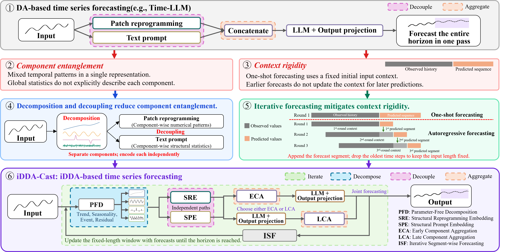

# iDDA-Cast: Iterative Decompose–Decouple–Aggregate for Time Series Forecasting

This repository provides the implementation of **iDDA-Cast**, a large language model (LLM)-based time series forecasting framework designed to address **component entanglement** and **context rigidity** in existing Decouple-and-Aggregate (DA) approaches such as Time-LLM.

iDDA-Cast introduces an iterative Decompose–Decouple–Aggregate (iDDA) architecture that explicitly models heterogeneous temporal patterns and updates the forecasting context across successive prediction segments.

The framework consists of five principal modules:

- **PFD (Parameter-Free Decomposition):** Decomposes a time series into trend, seasonality, event, and residual components without introducing trainable decomposition parameters.
- **SRE (Structural Reprogramming Embedding):** Converts component-specific numerical patterns into representations compatible with a pretrained LLM.
- **SPE (Structural Prompt Embedding):** Constructs component-aware prompts using global statistics and structural characteristics such as trend changes, periodicity, event occurrences, and residual fluctuations.
- **ECA and LCA (Early and Late Component Aggregation):** Provide two aggregation strategies for modeling component interactions or preserving component independence.
- **ISF (Iterative Segment-wise Forecasting):** Generates future predictions in successive segments, updating a fixed-length input window with preceding predictions and re-decomposing it before each subsequent prediction.

Two forecasting variants are provided:

- **iDDA-ECA** combines component representations before LLM inference, allowing interactions among structural components.
- **iDDA-LCA** processes each component independently through the LLM and sums the component forecasts afterward.



*Figure 1. Limitations of DA-based forecasting and how iDDA-Cast addresses them.*

## Installation

iDDA-Cast is implemented using Python, PyTorch, Hugging Face Transformers, and Accelerate. The experiments were conducted in the following environment:

| Package | Version |
|---|---|
| Python | 3.10 |
| PyTorch | 2.2.2 |
| CUDA | 11.8 |
| Transformers | 4.44.2 |
| Accelerate | 1.2.1 |
| DeepSpeed | 0.14.0 |
| NumPy | 1.23.5 |
| Pandas | 1.5.3 |

Clone the repository:

```bash
git clone https://github.com/anonymous-iDDA-Cast/iDDA-Cast.git
cd iDDA-Cast
```

Create a Python environment and install the dependencies:

```bash
conda create -n idda-cast python=3.10 -y
conda activate idda-cast
pip install -r requirements.txt
```

A CUDA-compatible PyTorch installation is required for GPU training.

## Datasets

We evaluate iDDA-Cast on eight multivariate time series forecasting datasets.

| Dataset | Domain | Samples | Variables |
|---|---|---:|---:|
| ETTh1 | Electricity | 14,307 | 7 |
| ETTh2 | Electricity | 14,307 | 7 |
| ETTm1 | Electricity | 57,507 | 7 |
| ETTm2 | Electricity | 57,507 | 7 |
| Weather | Meteorology | 52,603 | 21 |
| Exchange | Finance | 7,207 | 8 |
| Wind | Energy | 48,673 | 7 |
| AQShunyi | Air quality | 35,064 | 11 |

Obtain the original datasets from their respective sources and place them in the `dataset/` directory as follows:

```text
dataset/
├── ETT-small/       # ETTh1.csv, ETTh2.csv, ETTm1.csv, ETTm2.csv
├── weather/
├── exchange_rate/
├── wind/
├── AQShunyi/
└── prompt_bank/
```

## Quick Start

The following examples train and evaluate iDDA-LCA and iDDA-ECA on ETTh1. Run all commands from the repository root.

### 1. Prepare the dataset

Place `ETTh1.csv` in `dataset/ETT-small/` and make sure that `dataset/prompt_bank/ETT.txt` is available.

### 2. Run iDDA-LCA

ETTh1 with input length 512 and forecast horizon 96:

```bash
CUDA_VISIBLE_DEVICES=0 accelerate launch \
  --mixed_precision fp16 \
  --num_processes 1 \
  run_main.py \
  --task_name long_term_forecast \
  --is_training 1 \
  --model iDDA-LCA \
  --model_id ETTh1_512_96_LCA \
  --model_comment iDDA-LCA_ETTh1_96 \
  --data ETTh1 \
  --root_path ./dataset/ETT-small/ \
  --data_path ETTh1.csv \
  --features M \
  --target OT \
  --freq h \
  --embed timeF \
  --seq_len 512 \
  --label_len 48 \
  --pred_len 96 \
  --ar_len 96 \
  --enc_in 7 \
  --dec_in 7 \
  --c_out 7 \
  --llm_model GPT2 \
  --llm_dim 768 \
  --llm_layers 6 \
  --d_model 32 \
  --d_ff 128 \
  --n_heads 8 \
  --patch_len 16 \
  --stride 8 \
  --seasonal_patch_len 12 \
  --seasonal_stride 6 \
  --batch_size 8 \
  --learning_rate 0.0001 \
  --train_epochs 100 \
  --patience 10 \
  --prompt_domain 1 \
  --component_eval 0
```

### 3. Run iDDA-ECA

Use the same configuration and replace the model-related arguments:

```bash
--model iDDA-ECA
--model_id ETTh1_512_96_ECA
--model_comment iDDA-ECA_ETTh1_96
```

### 4. Change the forecast horizon

Set `--pred_len` to `192` or `336`. Keep the ISF segment length at `--ar_len 96`. For AQShunyi, use the same input length, forecast horizons, and ISF segment length as the other datasets.

Dataset-specific commands are provided in `scripts/`.

## Experimental Settings

Default configuration:

| Parameter | Value |
|---|---|
| LLM backbone | GPT-2 (6 Transformer layers) |
| Input length $I$ | 512 |
| Forecast horizon $H$ | 96 / 192 / 336 |
| ISF segment length $L_s$ | 96 |
| Model dimension / FFN dimension | 32 / 128 |
| Patch length / stride (trend, event, residual) | 16 / 8 |
| Patch length / stride (seasonality) | 12 / 6 |
| Seasonal period for decomposition | 24 |
| Event detection sensitivity $\lambda$ | 3.0 |
| Event scaling coefficient $\alpha$ | 0.5 |
| Mixed precision | FP16 |

Dataset-specific settings:

<!-- TODO: confirm the Exchange and Wind patch settings against the final experiment logs. -->
| Dataset | Batch size | Learning rate | Max epochs | Patch length / stride |
|---|---:|---:|---|---|
| ETTh1, ETTm1 | 8 | 1e-4 | 100 (early stopping, patience 10) | default |
| ETTh2, ETTm2, Weather, Wind, AQShunyi | 8 | 1e-4 | 10 | default |
| Exchange | 4 | 1e-5 | 10 | 20 / 10 (trend, event, residual), 10 / 5 (seasonality) |

For iDDA-Cast and all baselines, the batch size and learning rate were selected for each dataset as the combination with the lowest validation error.

<!-- TODO: confirm that this matches the evaluation protocol described in the paper. -->
The training script evaluates the model from the final training epoch rather than restoring the best validation checkpoint.

## Experimental Results

We compare iDDA-Cast with four LLM-based baselines (**Time-LLM, AutoTimes, Time-Prompt, and FPT**) and three non-LLM baselines (**PatchTST, TimesNet, and DLinear**) using mean squared error (MSE) and mean absolute error (MAE). Lower values indicate better accuracy.

- iDDA-Cast achieves the lowest MSE in **14 of 24** forecasting settings: nine on ETT, three on Exchange, and two on AQShunyi.
- At least one iDDA-Cast variant outperforms all three non-LLM baselines in **17 of 24** settings.
- Relative to Time-LLM, iDDA-Cast reduces short-term ($H=96$) and long-term ($H\in\{192,336\}$) MSE by up to **9.67%** and **17.8%**, respectively.
- Relative to AutoTimes, iDDA-Cast reduces long-term MSE by up to **9.57%**.
- Weather and Wind remain challenging: no iDDA-Cast variant achieves the lowest MSE at any tested horizon on either dataset.

### Forecasting Performance (MSE)

Bold indicates the lowest MSE in each setting.

| Dataset | $H$ | iDDA-LCA | iDDA-ECA | AutoTimes | Time-LLM | Time-Prompt | FPT | PatchTST | TimesNet | DLinear |
|---|---:|---:|---:|---:|---:|---:|---:|---:|---:|---:|
| ETTh1 | 96 | 0.3720 | **0.3664** | 0.3731 | 0.3760 | 0.3924 | 0.3802 | 0.3753 | 0.4510 | 0.3728 |
|  | 192 | **0.3979** | 0.4018 | 0.4231 | 0.4202 | 0.4554 | 0.4124 | 0.4106 | 0.4834 | 0.4033 |
|  | 336 | **0.4092** | 0.4154 | 0.4152 | 0.4181 | 0.4577 | 0.4250 | 0.4308 | 0.4837 | 0.4265 |
| ETTm1 | 96 | 0.3021 | 0.3024 | **0.2924** | 0.2941 | 0.3260 | 0.2973 | 0.3043 | 0.3301 | 0.3055 |
|  | 192 | **0.3325** | 0.3490 | 0.3382 | 0.3680 | 0.3741 | 0.3342 | 0.3388 | 0.3736 | 0.3368 |
|  | 336 | **0.3610** | 0.3717 | 0.3749 | 0.3657 | 0.3732 | 0.3650 | 0.3660 | 0.3801 | 0.3669 |
| ETTh2 | 96 | 0.2810 | **0.2779** | 0.2876 | 0.3041 | 0.3133 | 0.2849 | 0.3040 | 0.3862 | 0.3185 |
|  | 192 | 0.3479 | **0.3469** | 0.3639 | 0.3688 | 0.4050 | 0.3561 | 0.3817 | 0.4089 | 0.4238 |
|  | 336 | **0.3694** | 0.3717 | 0.4020 | 0.4028 | 0.4405 | 0.3812 | 0.3957 | 0.4081 | 0.5300 |
| ETTm2 | 96 | 0.1705 | 0.1698 | **0.1679** | 0.1766 | 0.1785 | 0.1701 | 0.1711 | 0.2072 | 0.3061 |
|  | 192 | 0.2294 | 0.2366 | 0.2380 | 0.2395 | 0.2359 | 0.2346 | **0.2268** | 0.2594 | 0.3371 |
|  | 336 | **0.2904** | 0.2925 | 0.2931 | 0.2961 | 0.2928 | 0.3117 | 0.2977 | 0.3136 | 0.3671 |
| Weather | 96 | 0.1588 | 0.1517 | 0.1595 | 0.1494 | **0.1475** | 0.1538 | 0.1484 | 0.1819 | 0.1672 |
|  | 192 | 0.2034 | 0.2013 | 0.2086 | **0.1935** | 0.2002 | 0.2088 | 0.1996 | 0.2187 | 0.2114 |
|  | 336 | 0.2523 | 0.2503 | 0.2768 | **0.2463** | 0.2471 | 0.2844 | 0.2665 | 0.2668 | 0.2589 |
| Exchange | 96 | 0.0858 | **0.0822** | 0.0860 | 0.0910 | 0.1187 | 0.1006 | 0.0905 | 0.2500 | 0.1231 |
|  | 192 | 0.1787 | **0.1759** | 0.1882 | 0.2139 | 0.2676 | 0.2024 | 0.1970 | 0.3571 | 0.2514 |
|  | 336 | 0.3694 | **0.3400** | 0.3705 | 0.3890 | 0.4716 | 0.3760 | 0.3886 | 0.6770 | 0.5275 |
| Wind | 96 | 0.9046 | 0.8943 | 0.9117 | **0.8900** | 0.9164 | 0.9003 | 0.8959 | 0.9356 | 0.8908 |
|  | 192 | 1.0893 | 1.0823 | 1.0825 | 1.0631 | 1.0853 | 1.0861 | 1.0777 | 1.0888 | **1.0482** |
|  | 336 | 1.2503 | 1.2460 | 1.2203 | 1.1978 | 1.2360 | 1.2274 | 1.2123 | 1.2314 | **1.1658** |
| AQShunyi | 96 | 0.6504 | 0.6506 | **0.6466** | 0.6472 | 0.6516 | 0.6509 | 0.6505 | 0.6770 | 0.6484 |
|  | 192 | **0.6897** | 0.7041 | 0.6944 | 0.7044 | 0.7263 | 0.6961 | 0.6947 | 0.6984 | 0.6906 |
|  | 336 | **0.7100** | 0.7115 | 0.7157 | 0.7292 | 0.7278 | 0.7147 | 0.7147 | 0.7126 | 0.7124 |

### Component Ablation (ETTh1, iDDA-LCA)

When $T$, $S$, or $E$ is removed, its values are added to the residual. When $R$ is removed, it is discarded and the other three component forecasts are summed.

| Variant | MSE (96) | MAE (96) | MSE (192) | MAE (192) |
|---|---:|---:|---:|---:|
| iDDA-LCA | **0.3720** | **0.4036** | **0.3979** | **0.4229** |
| w/o Trend | 0.4331 | 0.4556 | 0.4729 | 0.4646 |
| w/o Seasonality | 0.5100 | 0.4956 | 0.5391 | 0.5058 |
| w/o Event | 0.3858 | 0.4154 | 0.4295 | 0.4502 |
| w/o Residual | 0.4223 | 0.4392 | 0.4505 | 0.4531 |

Removing seasonality causes the largest degradation, increasing MSE by 37.1% at $H=96$ and 35.5% at $H=192$.

### Module Ablation (ETTh2, iDDA-LCA)

| Variant | MSE (96) | MAE (96) | MSE (192) | MAE (192) |
|---|---:|---:|---:|---:|
| iDDA-LCA | **0.2810** | **0.3414** | **0.3479** | **0.3847** |
| w/o SRE | 0.3991 | 0.4377 | 0.4718 | 0.5481 |
| w/o SPE | 0.2912 | 0.3484 | 0.3808 | 0.4015 |
| w/o ISF | 0.2815 | 0.3421 | 0.3817 | 0.4020 |

SRE has the largest impact. SPE and ISF provide complementary gains; ISF improves MSE by 9.72% at $H=192$, where the second segment uses the updated input window. At $H=96$, forecasting requires only one segment, so ISF performs no iterative update.

## Baseline Models

| Model | Type | Description |
|---|---|---|
| Time-LLM | LLM-based | Reprogramming and prompting with a frozen LLM |
| AutoTimes | LLM-based | Autoregressive forecasting with an LLM |
| Time-Prompt | LLM-based | Hard and soft prompts with cross-attention and gating |
| FPT | LLM-based | Forecasting with a frozen pretrained Transformer |
| PatchTST | Non-LLM | Patch-based Transformer |
| TimesNet | Non-LLM | Temporal variation modeling with 2D transformations |
| DLinear | Non-LLM | Linear forecasting with trend–seasonal decomposition |

## File Descriptions

<!-- TODO: Python cannot import module files whose names contain hyphens. Rename the model files to iDDA_ECA.py and iDDA_LCA.py, or update this table to the actual file names. -->
| File or Directory | Description |
|---|---|
| `run_main.py` | Main training and evaluation entry point |
| `models/iDDA_ECA.py` | iDDA-Cast with early component aggregation |
| `models/iDDA_LCA.py` | iDDA-Cast with late component aggregation |
| `models/TimeLLM.py` | Time-LLM baseline implementation |
| `models/` | Other forecasting baseline implementations |
| `layers/` | Shared neural network and embedding layers |
| `data_provider/` | Dataset loading and preprocessing |
| `utils/` | Evaluation metrics, learning utilities, and supporting functions |
| `scripts/` | Dataset-specific experiment commands |
| `dataset/prompt_bank/` | Dataset-specific textual descriptions |
| `ds_config_zero2.json` | DeepSpeed ZeRO configuration |
| `requirements.txt` | Python dependencies |
| `environment.yml` | Conda environment configuration |
| `LICENSE` | Apache License 2.0 text |

## License

This project is distributed under the [Apache License 2.0](LICENSE). Portions of the code are adapted from [Time-LLM](https://github.com/KimMeen/Time-LLM) (Apache License 2.0), and the original copyright notices are retained.

Some third-party files may carry separate license terms. For example, `utils/losses.py` contains a CC BY-NC 4.0 notice associated with N-BEATS code from Element AI Inc. and remains subject to that license. See [LICENSE](LICENSE) for details.

## Citation

Citation information will be added upon publication.
